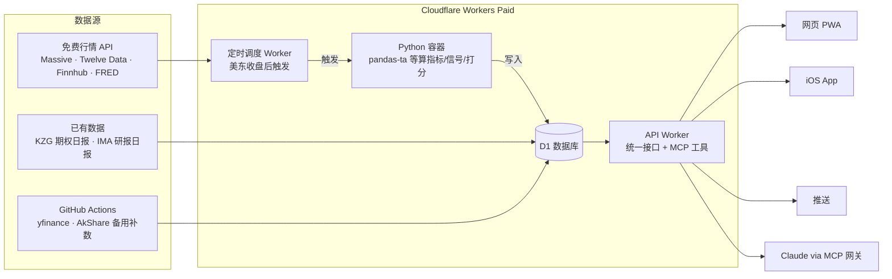

# 个股声呐 Stock Sonar 项目计划书

> 2026-11-06 · wenjin
> 在线版（可评论）：https://claude.ai/artifact/MrV6MSNXz48egocrAqEao5
> 设计稿：https://claude.ai/artifact/9cmeZdAA6UgXHAER5Amwhs （源文件见 `design/`）

## 项目概述

个股声呐是一个自用的美股技术面扫描工具：每天收盘后自动计算技术指标，结合期权日报和研报数据，输出一份「今日机会清单」。它是独立项目，与 ChainLens 无关（ChainLens 已放弃）。

**目标**

- 低频发现机会：每天看一次清单即可，不需要盯盘。
- 指标规则严格设计：每个信号有明确公式、触发条件和打分。
- 跨数据源共振：技术面 + 期权异动 + 研报观点，按股票代码绑定。
- 全部部署在 Cloudflare，5 美元/月 Workers Paid 套餐内运行，不买服务器。
- 自用为主：网页版（PWA）+ iOS TestFlight，后续可加桌面版。

**不做什么**

- 不做盘中实时行情、不做下单交易。
- 不用回测反复调参；历史表现只作参考展示。
- 第一阶段不接富途、长桥等券商接口。

## 已确定的决策

以下事项已定，开发时不再讨论；要改先改这张表。

| 事项 | 决定 |
| --- | --- |
| 仓库 | `wenjinliuu/stock-sonar`（私有） |
| 市场 | 只做美股 |
| 股票池 | 标普 500 ∪ 纳指 100 ∪ 期权池 ∪ 研报覆盖 ∪ AI 主题，约 550 只，可快速增删 |
| 部署 | 全部在 Cloudflare（Workers Paid 5 美元/月），不买服务器 |
| 视觉 | 专业交易软件风，配色参考币安亮色：白底、无悬浮卡片、高密度、黄色选中下划线，绿涨红跌 |
| 推送渠道 | 只用 iOS 通知（App 上线前用 PWA 网页推送） |
| 推送条件 | 只在出现高分共振机会时推；普通上榜只在 App 里看 |
| 访问保护 | Cloudflare Access，只放行用户邮箱（邮箱验证码登录） |
| AI 点评 | 第一版纯规则，不加 AI；P3 再考虑 |
| 域名 | 先用 workers.dev，以后再绑自定义域名 |
| 前端 | React + Vite 做 PWA，部署在 Workers 静态资源；K 线用 KLineChart |
| iOS | SwiftUI 原生，调同一套 API，走 ios-ci-workflows 上 TestFlight，推送走 APNs |
| 开发方式 | Claude Code 云端会话写代码，GitHub 推送后自动部署 |

## 核心功能

核心是「每日扫描 → 机会清单」，走势图只用来确认信号位置。

1. **股票池**：约 550 只，见「股票池」一节。
2. **每日扫描**：美东收盘后约 1 小时（北京时间早上 5–6 点）拉日线、合成周线，计算全部指标和信号。
3. **机会清单**：按综合分排序，每条写清触发了哪些信号、是否有期权/研报共振。
4. **个股页**：K 线 + 指标副图 + 信号标记；同一时间轴标注期权异动、研报评级/目标价变化、新闻。
5. **信号历史表现**：每类信号出现后 5 日 / 20 日的涨跌分布，只展示不调参。
6. **推送**：只用 iOS 通知，只推高分共振；App 上线前先用 PWA 网页推送。
7. **AI 接口**：把个股数据包成 MCP 工具（经 cloudflare-mcp-gateway），让 Claude 直接查询和解读。

## 股票池

约 550 只美股：标普 500 ∪ 纳指 100 ∪ 期权日报池 ∪ 研报覆盖股 ∪ AI 主题清单，去重后全部每日扫描。

| 层级 | 来源 | 处理方式 |
| --- | --- | --- |
| 核心池 | AI 主题清单 + 期权日报池 + 近 30 天有研报的股票 | 全部信号；上榜门槛较低；推送优先 |
| 扩展池 | 标普 500、纳指 100 其余成分股 | 全部信号；上榜门槛更高（如需 4 类同向） |
| 自定义 | 手动添加 | 按核心池处理 |

**维护方式**

- App 内搜索代码，一键加入或移除。
- 期权池、研报覆盖股每天自动同步；指数成分股每季度自动同步一次。
- 每只股票可打多个标签（如 AI 算力、存储、电力），清单可按标签筛选。

## UI 设计

专业交易软件风，配色参考币安亮色模式；手机优先，网页和 iOS 用同一套设计。设计稿源文件在 `design/`。

**设计语言**

- 纯白背景，不用悬浮卡片，用细分隔线（`#EAECEF`）和 8px 窄灰条（`#F5F5F5`）分区；小圆角、信息密度高、图表占满屏宽。
- 文字：主 `#1E2329`，次 `#707A8A`，辅助 `#929AA5`；数字用等宽数字（tabular-nums）。
- 涨跌：K 线/色块绿 `#2EBD85`、红 `#F6465D`；文字绿 `#03A66D`、红 `#CF304A`。
- 强调：选中标签页黄色下划线 `#F0B90B`，主按钮 `#FCD535`，开关打开为黄色。
- 指标线每条一种颜色（黄 `#F0B90B`、粉 `#E04A9B`、紫 `#8B6CEF`、蓝 `#4D7CFE`），图例文字与线同色并显示当前值。

**页面**

| 页面 | 内容 | 主要操作 |
| --- | --- | --- |
| 今日（首页） | 顶部 SPY/QQQ/VIX 一行概况和上榜数；标签页 全部/看多/看空/共振/AI 核心；列表：代码/名称、触发信号、右侧实色色块显示综合分和方向（绿看多/红看空）；共振用黄底小标签 | 筛选；点行进个股页 |
| 个股页 | 顶部代码（带下拉切换）+ AI/收藏/提醒图标；标签页 行情/信号/期权/研报/新闻；大号价格 + 右侧最高/最低/成交量/52 周高；「声呐 综合分 · 方向 · 共振」可点击行；周期栏（日/周/月 + 更多 + 指标设置 + 模板）；K 线（区间最高最低价引线标注、当前价描边框 + 虚线、右侧价格轴、日期轴、全屏按钮）；成交量（MA5/MA10）；指标副图；底部「设提醒」「看信号详情」 | 切换周期、指标、模板 |
| 指标抽屉 | 标签页 TradingView 热门/美股专用/基础/已添加；列表：名称/作者、点赞数、主图或副图、开关 | 搜索、开关指标 |
| 股票池 | 按层级和标签分组的列表 | 搜索添加、一键删除、改标签 |
| 信号库 | 每个信号的定义、公式说明、历史表现 | 开关某个信号 |
| 设置 | 推送条件、数据源状态、运行记录 | 改推送门槛 |

**交互原则**

- 打开就是今日清单，首屏即答案。
- 每条信号都能点开看「为什么触发」。
- 图表只在个股页出现。

## 指标面板与 K 线交互

这是本项目的重点：个股页的 K 线图要能快速切换丰富的指标；期权和研报只是接入现成数据，工作量小。

**指标库**

选指标的原则：基础指标之外，只选 TradingView 社区里用的人最多、口碑最好、且源码公开的指标；神奇九转、缠论、筹码分布这类 A 股习惯的指标不做。热度参考 TradingView 点赞排行（[来源](https://blog.pickmytrade.io/top-free-indicators-and-strategies-on-tradingview/)）。

| 指标 | 作者 | TradingView 点赞 | 位置 | 用途 |
| --- | --- | --- | --- | --- |
| Squeeze Momentum | LazyBear | 97.4K | 副图 | 波动收缩后的突破方向 |
| Smart Money Concepts | LuxAlgo | 78.2K | 主图 | 市场结构（BOS/CHoCH）、订单块、缺口 |
| MACD 多周期版 | ChrisMoody | 70.4K | 副图 | 日线上同时看周线 MACD |
| Williams Vix Fix | ChrisMoody | 56.4K | 副图 | 恐慌低点（找底） |
| SuperTrend | KivancOzbilgic | 55K | 主图 | 趋势方向与止损线 |
| WaveTrend | LazyBear | 52.3K | 副图 | 超买超卖与交叉 |
| ADX and DI | BeikabuOyaJi | 41.6K | 副图 | 趋势强度 |
| 支撑压力及突破 | LuxAlgo | 33.8K | 主图 | 自动画支撑压力位并标突破 |

- 基础指标（内置）：MA/EMA、布林带、成交量、MACD、RSI、ATR。
- 美股专用：相对强度 RS 线（对 SPY / QQQ）、Minervini 趋势模板、锚定 VWAP（从财报日或前高锚定）、成交量分布。
- 自有：信号标记、期权异动与研报事件标记、综合分走势。
- 移植方式：从开源 Pine Script 翻译成 TypeScript（图表）和 Python（信号）；也可参考开源的 [PineTS](https://www.luxalgo.com/pinets/)。各作者脚本许可证不同，自用没问题，移植时逐个记录在 `docs/indicator-licenses.md`。

**交互**

- 指标抽屉：按类别分组、可搜索，开关即加到主图或副图；主图最多叠 3 个、副图最多 3 个。
- 一键模板：趋势跟随、挤压突破、超跌反弹、SMC 结构等预设组合，也可保存自己的模板。
- 周期与范围：日线/周线/月线；3 个月、6 个月、1 年、2 年。
- 参数可改（如 MA 周期）；记住上次的指标组合。
- 十字光标显示当天所有指标数值；信号和事件标记可单独开关；支持横屏全屏。

**实现方式**

- 图上的指标在前端用 TypeScript 即时计算：每只最多约 500 根日线，切换几乎无延迟，不把指标序列存进 D1。
- KLineChart 自带的常用指标直接用；扩展指标注册为自定义指标。
- SMC 市场结构、支撑压力位这类需要回看摆动点的指标在 Python 容器里算好存入 D1，前端只负责画。
- 信号判断在 Python 端做，图上显示在 TS 端做：同一指标两端各一份公式，用固定样本数据比对结果（golden test），保证图上看到的和信号一致。

## 技术架构

全部跑在 Cloudflare，不需要服务器：Worker 负责调度和接口，Python 容器负责计算，D1 是唯一的数据中心。

- 定时 Worker 在美东收盘后拉数据并启动容器；容器算完后写入 D1 并自动休眠（`sleepAfter`）。
- 所有终端只调同一个 API Worker；网页由 Cloudflare Access 保护。
- yfinance / AkShare 这类抓取型数据源放在 GitHub Actions 跑，避免从 CF 的 IP 直连被拦。

## 数据源

第一阶段全部用免费源：日线级数据就够用，期权和研报沿用已有数据。

| 数据 | 来源 | 免费额度 | 运行位置 |
| --- | --- | --- | --- |
| 日线 K 线（主力） | [Massive Stocks Basic](https://massive.com/pricing) | 5 次/分钟，2 年历史，收盘数据 | CF Worker 定时任务 |
| 当前价格刷新 | [Twelve Data Basic](https://twelvedata.com/pricing) | 8 次/分钟，800 次/天 | CF Worker（按需） |
| 新闻、公司资料、基本面 | Finnhub（已在用） | 60 次/分钟；K 线接口免费版不可用 | CF Worker |
| 期权异动 | KZG 期权日报（kzg-option-brief） | 已有 | 读现有 CF 数据 |
| 研报观点、目标价 | IMA 研报日报（ima-knowledge-mcp） | 已有 | 读现有 CF 数据 |
| 备用补数、期权链 | yfinance / AkShare | 非官方，可能限流 | GitHub Actions |
| 宏观 | FRED | 免费 | CF Worker |

- 日线用 Massive 的 Grouped Daily 接口：一次请求返回全市场当天日线，每天 1 次调用覆盖整个股票池。
- 首次回补 2 年约 500 次请求，按 5 次/分钟约 100 分钟，分批跑一次。**P0 需先验证免费版能调这个接口。**
- 以后若需要盘中实时期权报价，再考虑长桥 OpenAPI 的 OPRA 行情卡。

## 技术指标与信号体系

单个指标只产生「信号」，多个同向信号叠加才算「机会」；阈值按每只股票自己的历史分布来定。

**五类指标（第一版信号）**

| 类别 | 指标 | 信号示例 |
| --- | --- | --- |
| 趋势 | MA20/50/200、SuperTrend | 多头排列、站上/跌破 MA200、回踩 MA50 不破、SuperTrend 翻多/翻空 |
| 动量 | RSI、MACD | RSI 到自身 10%/90% 分位、MACD 金叉死叉、顶底背离 |
| 波动 | 布林带、ATR | 布林带宽度到自身低分位（收口）、ATR 扩张 |
| 量能 | 成交量比、OBV | 放量突破（量比 > 自身 90% 分位）、量价背离 |
| 位置 | 52 周高低点、均线偏离 | 创 52 周新高、偏离 MA50 超过 2 倍 ATR |

第二版把 Squeeze Momentum、WaveTrend、Williams Vix Fix、SMC 等 TradingView 热门指标也做成信号。

**规则原则**

- 阈值自适应：用该股近 250 个交易日的分位数，不用全市场统一的固定值。
- 方向明确：每个信号标注看涨/看跌和周期（日线/周线）。
- 周线定方向，日线找位置：与周线趋势同向的日线信号加分。

**打分**

- 每个信号 1–3 分（按强度）；同向技术信号来自 3 类及以上才入清单（扩展池需 4 类）。
- 共振加分：同向期权异动 +3，近 7 天研报上调评级或目标价 +2。
- 推送门槛（暂定）：综合分 ≥ 8，且期权或研报至少一项与技术面同向。
- 具体分值和公式在 P1 写成 `docs/signals.md` 规格，定稿后不用回测调参。

## 数据模型

所有表都以 `ticker` 为主键之一，存在 D1；KV 只放缓存。

| 表 | 主要字段 | 说明 |
| --- | --- | --- |
| `tickers` | ticker, name, tier, tags, active | 股票池（层级 + 标签） |
| `bars_daily` | ticker, date, open, high, low, close, volume | 日线，保留 ≥ 500 个交易日 |
| `indicators_daily` | ticker, date, name, value | 信号所需的每日指标快照（含自身分位数） |
| `structures` | ticker, date, kind, payload_json | SMC 结构、支撑压力位等需回看计算的结果 |
| `signals` | ticker, date, signal_id, direction, timeframe, strength | 当天触发的信号 |
| `opportunities` | date, ticker, score, direction, resonance, reasons_json | 每日机会清单 |
| `signal_stats` | signal_id, horizon, n, win_rate, median_return | 信号历史表现（只展示） |
| `events` | ticker, date, source, kind, summary, url | 期权异动、研报变化、新闻，统一时间轴 |
| `push_log` | date, ticker, channel, status | 推送记录 |
| `runs` | run_id, started_at, status, error | 每次扫描的运行记录 |

期权和研报数据由本项目定时从各自项目的 CF 数据读取，统一归入 `events` 表（P0 先确认它们当前的存放位置和格式）。

## 分期路线

先把「数据 → 信号 → 清单」主线跑通（P0–P1），每期过了关口再进入下一期；没有定日期。

| 阶段 | 内容 | 关口 |
| --- | --- | --- |
| P0 基础搭建 | 仓库结构、Wrangler 配置、D1 建表、Massive 日线拉取与 2 年回补、股票池初始化、Cloudflare Access | 约 550 只股票 2 年日线完整入库 |
| P1 指标与信号（核心） | 写定 `docs/signals.md`；Python 容器算五类指标与信号、打分；生成机会清单；PWA 网页推送 | 连续 5 个交易日自动出清单 |
| P2 个股页与共振 | 网页 PWA：今日页、个股页（KLineChart + 信号标记 + 指标抽屉）；接入期权、研报事件，加共振打分 | 任意个股能同时看到技术面、期权、研报 |
| P3 AI 与扩展指标 | MCP 工具接 Claude；TradingView 热门指标做成信号；信号历史表现 | Claude 能查询任意个股的信号 |
| P4 iOS App | SwiftUI 调同一套 API，经 ios-ci-workflows 上 TestFlight，APNs 推送 | App 收到第一条共振推送 |

## 成本与额度

预计每月只付 5 美元的 Workers Paid 套餐，各项用量都远低于包含额度（[官方价格页](https://developers.cloudflare.com/workers/platform/pricing/)）。

| 项目 | 套餐含量（每月） | 本项目估算 |
| --- | --- | --- |
| Workers 请求 | 1000 万次 | 几万次 |
| Workers CPU | 3000 万 ms | 远低于额度（等待接口不计 CPU） |
| 定时任务单次 CPU | 最长 15 分钟 | 分批跑，每批数分钟 |
| D1 读 / 写 | 250 亿行 / 5000 万行 | 每天写入约 1–2 万行 |
| Containers 内存 | 25 GiB-小时 | basic 规格每天 10 分钟 ≈ 5 GiB-小时 |
| Containers CPU | 375 vCPU-分钟 | ≈ 75 vCPU-分钟 |

- 额度按整个 CF 账号计算，和期权日报、IMA 爬虫、MCP 网关等项目共用。
- 容器必须设置空闲自动休眠（`sleepAfter`），否则会超额计费。
- 存数据优先用 D1，KV 写入单价高。
- 大模型费用（如 DeepSeek）不在套餐内。
- 开通后设置账单提醒，建议超过 8 美元就通知。

## 风险与待定事项

| 风险 | 影响 | 应对 |
| --- | --- | --- |
| 免费 API 改额度或停服 | 数据断更 | 数据层做适配器，可切换 Massive / Twelve Data / yfinance |
| yfinance、AkShare 被限流 | 补数失败 | 只当备用，放 GitHub Actions 跑 |
| CF 默认域名国内访问慢 | App 和网页打不开 | 先用 workers.dev（国内可能需代理），以后绑自定义域名 |
| 信号太多、噪音大 | 清单没法看 | 「3 类同向才入清单」的门槛 + 每天最多展示前 10 名 |
| 日线算不了订单流类指标 | 主力资金等只是近似 | 在界面上标明「近似」 |
| 开源指标许可证限制 | 以后对外提供时受限 | 移植前记录每个指标的许可证 |

**待定事项**

- [x] 确定仓库名并创建仓库（stock-sonar）
- [ ] 整理 AI 主题股票清单（补充标普、纳指以外的 AI 股）
- [ ] 定义「高分共振」的推送门槛（写进信号规格）
- [ ] 注册 Massive、Twelve Data 免费 key
- [ ] 开通 CF Workers Paid 并设账单提醒
- [ ] 确认期权日报、研报日报数据当前在 CF 里的存放位置和格式
